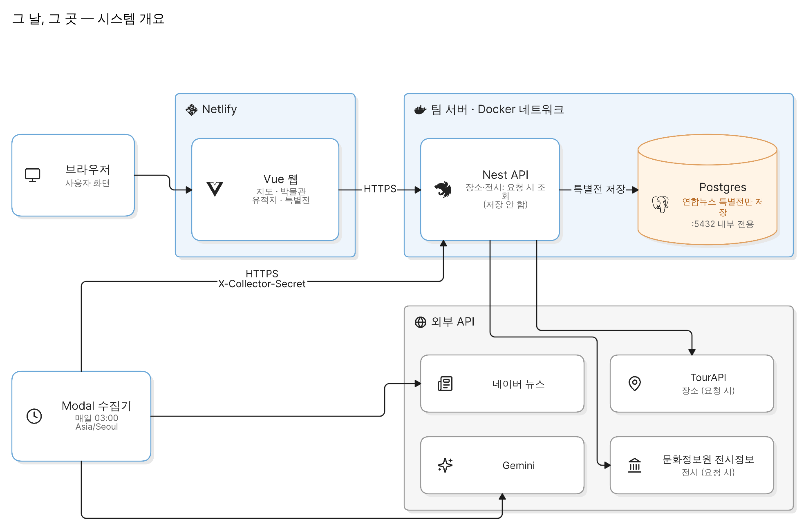
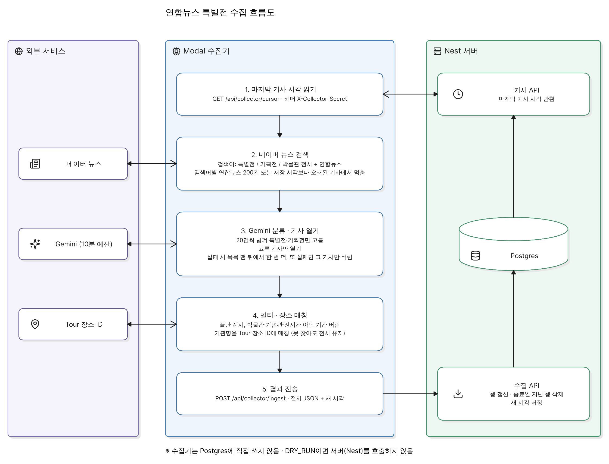

# 아키텍처

화면은 Netlify, API와 Postgres는 팀 서버의 Docker, 수집기는 Modal이다. 장소와 전시정보(통합)는 요청할 때 읽고, 연합뉴스에서 만든 특별전만 DB에 남긴다.

## 시스템

| 구성 요소     | 실행 형태                      | 하는 일                                        |
| ------------- | ------------------------------ | ---------------------------------------------- |
| **web**       | Netlify. Vue 빌드              | 지도, 박물관, 유적지, 특별전                   |
| **server**    | 팀 서버 Docker. Nest           | `/api`. TourAPI·전시정보(통합)을 대신 호출     |
| **Postgres**  | 같은 compose. 포트는 망 안에만 | `exhibitions`, `news_collect_cursors`, `users` |
| **collector** | Modal. 매일 03:00 Asia/Seoul   | 연합뉴스를 골라 전시 JSON을 서버에 보냄        |

브라우저와 Modal은 `https://<API 도메인>`으로 Nest에 닿는다. Postgres `5432`는 인터넷에 열지 않는다.

## 전시가 화면에 나오기까지

1. 화면이 `GET /api/exhibitions`를 호출한다.
2. Nest가 Postgres의 수집 행을 읽는다.
3. Nest가 전시정보(통합) `API_CCA_145`를 읽고 10분 동안 메모리에 둔다. 이 결과는 DB에 넣지 않는다.
4. 수집 행 가운데 통합 목록과 같은 전시는 빼고, 통합 행을 더한다.
5. 종료된 행과 박물관·기념관·전시관이 아닌 기관을 뺀다. 예정·진행은 시작일과 오늘로 다시 계산한다.

장소 핀은 이 경로와 따로다. `GET /api/places/map`이 TourAPI를 읽고, 장소 표는 없다.

## 수집

1. Modal이 `GET /api/collector/cursor`로 마지막 기사 시각을 읽는다. 헤더는 `X-Collector-Secret`이다.
2. 검색어 세 개(`특별전 연합뉴스`, `기획전 연합뉴스`, `박물관 전시 연합뉴스`)로 네이버 뉴스를 읽는다. 처음에는 검색어마다 연합뉴스 200건이 차면 멈춘다. 못 본 구간이 있으면 새 기사와 그 구간만 읽고, 구간 시작보다 오래된 기사는 보지 않는다.
3. 20건씩 Gemini에 넘겨 특별전·기획전만 고르고, 고른 기사만 연다. 페이지가 안 열리면 목록 맨 뒤에서 한 번 더 열고, 그래도 안 열리면 그 기사만 버린다. Gemini는 재시도를 포함해 10분이다.
4. 끝난 전시와 박물관·기념관·전시관이 아닌 기관은 버린다. 기관명은 Tour 장소 ID에 붙여 보고, 못 찾아도 전시는 남긴다.
5. 끝난 앞부분에서 같은 전시를 한 건으로 모은 뒤, 40건이 되면 `POST /api/collector/ingest`로 보내고, 실행이 끝날 때 남은 것도 보낸다. 서버는 같은 기관의 같은 제목이면 그 행의 종료일·요약·기사 주소를 갱신하고, 종료일이 지난 행을 지우고, 본 시각과 못 본 구간을 저장한다.

수집기는 Postgres에 직접 쓰지 않는다. `DRY_RUN=true`는 서버를 부르지 않는다.

## 배포

| 자리    | 무엇을 올리나                                                                                          |
| ------- | ------------------------------------------------------------------------------------------------------ |
| Netlify | `web/dist`. 빌드 때 `VITE_API_BASE_URL`, `VITE_KAKAO_MAP_KEY`                                          |
| 팀 서버 | `docker/docker-compose.yaml`. Nest와 Postgres. `CORS_ORIGIN`은 Netlify 주소                            |
| Modal   | `collector/modal_app.py`. 시크릿 `geunal-collector`. `modal deploy` 전에는 새벽 실행이 등록되지 않는다 |

서버 환경에 `TOUR_API_KEY`, `CULTURE_API_KEY`, `COLLECTOR_INGEST_SECRET`이 있어야 한다. 수집 비밀은 Modal과 같은 값이고, 비어 있으면 수집 API는 거절한다. `DATABASE_URL`은 compose가 망 안의 `postgres:5432`로 만든다.

표는 Drizzle 마이그레이션이 만든다. 수집 시각 표는 `server/drizzle/0003_news_collect_cursors.sql`이다.

## 아직 없는 것

수집 시각을 페이지에서 바꾸는 내부 설정은 없다. 크론은 매일 03:00으로 고정이다.
