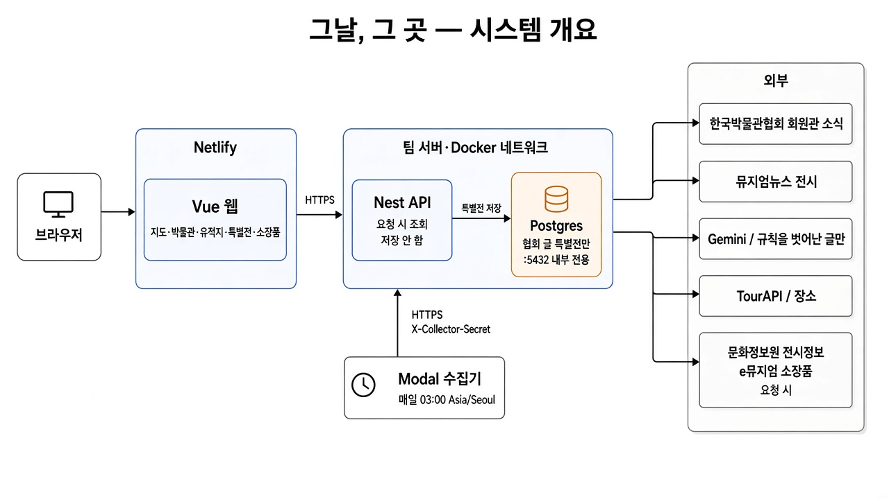
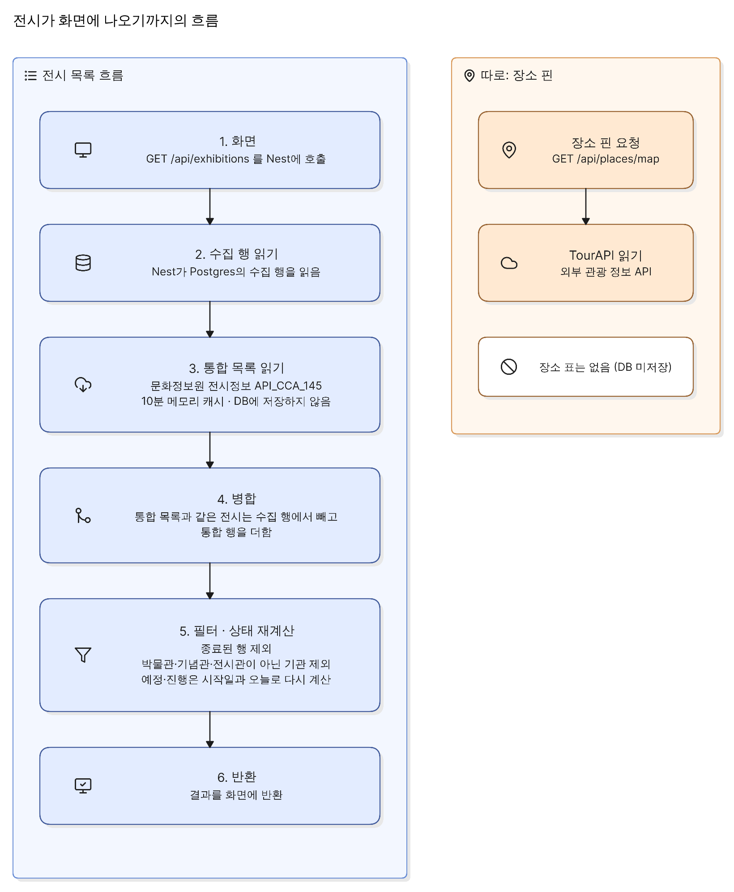
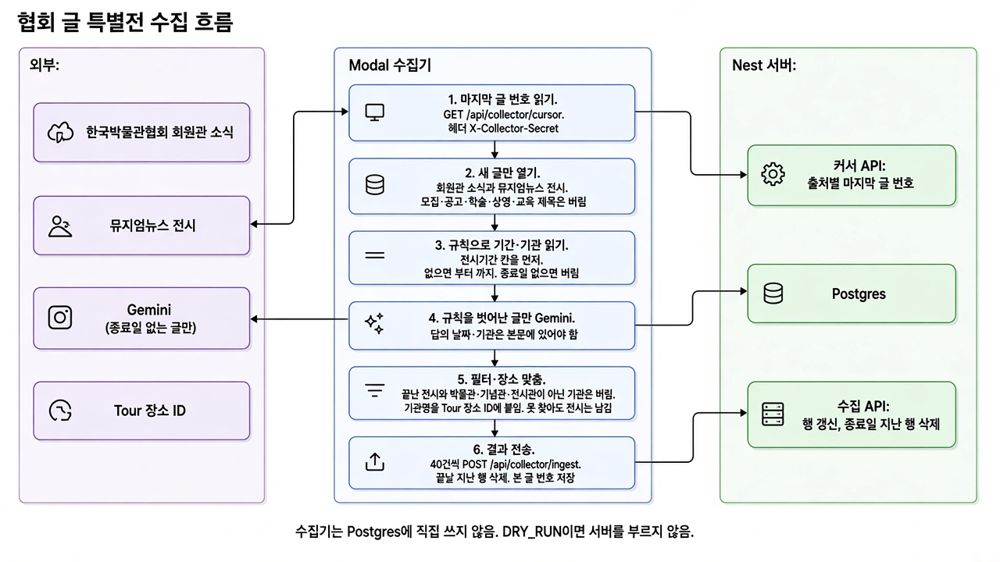

# 아키텍처

화면은 Netlify, API와 Postgres는 팀 서버의 Docker, 수집기는 Modal이다. 장소, 전시정보(통합), 소장품은 요청할 때 읽고, 협회 글에서 만든 특별전만 DB에 남긴다.

## 시스템

| 구성 요소     | 실행 형태                      | 하는 일                                            |
| ------------- | ------------------------------ | -------------------------------------------------- |
| **web**       | Netlify. Vue 빌드              | 지도, 박물관, 유적지, 특별전, 소장품               |
| **server**    | 팀 서버 Docker. Nest           | `/api`. TourAPI·전시정보(통합)·e뮤지엄을 대신 호출 |
| **Postgres**  | 같은 compose. 포트는 망 안에만 | `exhibitions`, `collect_cursors`, `users`          |
| **collector** | Modal. 매일 03:00 Asia/Seoul   | 협회 글에서 전시를 골라 JSON을 서버에 보냄         |

브라우저와 Modal은 `https://<API 도메인>`으로 Nest에 닿는다. Postgres `5432`는 인터넷에 열지 않는다.

## 전시가 화면에 나오기까지

1. 화면이 `GET /api/exhibitions`를 호출한다.
2. Nest가 Postgres의 수집 행을 읽는다.
3. Nest가 전시정보(통합) `API_CCA_145`를 읽고 10분 동안 메모리에 둔다. 이 결과는 DB에 넣지 않는다.
4. 수집 행 가운데 통합 목록과 같은 전시는 빼고, 통합 행을 더한다.
5. 종료된 행과 박물관·기념관·전시관이 아닌 기관을 뺀다. 예정·진행은 시작일과 오늘로 다시 계산한다.

장소 핀은 이 경로와 따로다. `GET /api/places/map`이 TourAPI를 읽고, 장소 표는 없다.

## 수집

출처는 둘이다.

- 한국박물관협회 회원관 소식. <https://museum.or.kr/museums_news/>
- 뮤지엄뉴스 전시. <https://museumnews.kr/category/exhibition/>

전시정보(통합)은 수집하지 않는다. 화면이 그 API를 직접 읽는다.

1. Modal이 `GET /api/collector/cursor`로 출처마다 마지막으로 본 글 번호를 읽는다. 헤더는 `X-Collector-Secret`이다.
2. 그 번호보다 새로운 글만 연다. 요청은 1초에 한 번보다 촘촘하지 않고, User-Agent에 서비스 이름을 넣는다.
3. 제목에 모집, 공고, 학술, 세미나, 상영, 교육, 워크숍, 성료, 발간이 있으면 그 글은 열지 않는다.
4. 기간과 기관은 규칙으로 읽는다. `전시기간`, `기간`, `장소` 칸을 본문 문장보다 먼저 본다. 칸이 없으면 본문 전체에서 `부터 … 까지`를 모두 잡는다. 개막일 하나만 있는 날짜는 기간이 아니다. 그 문장에 기관이 있으면 그 기관이 장소이고, 없으면 제목의 `[…]`를 쓴다. 연도가 없으면 글 작성 연도이고, `내년`은 그 다음 해다. `9월 1일부터 30일까지`는 같은 달 30일이다. 종료일만 있으면 시작일은 비운다. 한 글의 기간이 둘이면 행도 둘이다. 끝난 구간은 버린다.
5. 전시처럼 보이는데 종료일이 없거나, 기간이 둘 이상인데 기관이 그 문장에 안 붙으면 그 본문만 Gemini에 보낸다. 받는 값은 제목, 기관, 시작일, 종료일이다. 날짜의 월·일과 기관명은 본문에 있어야 하고, 없으면 그 답은 버린다. 소개 문장은 받지 않는다. 규칙이 읽은 글은 Gemini에 다시 보내지 않는다.
6. 이미지는 페이지에 있는 주소만 쓴다. 뮤지엄뉴스는 대표 이미지이고, 없으면 `og:image`다. 회원관 소식은 본문 그림이 있을 때만 쓴다. 파일명에 logo, icon이 있거나 크기가 아주 작은 파일은 버린다. 파일은 우리 서버에 복사하지 않는다. 소개는 기관과 기간만 적는다.
7. 끝난 전시와 박물관·기념관·전시관이 아닌 기관은 버린다. 기관명은 Tour 장소 ID에 붙여 보고, 못 찾아도 전시는 남긴다. 통합 목록과 같은 전시는 넣지 않는다.
8. 40건이 되면 `POST /api/collector/ingest`로 보내고, 실행이 끝날 때 남은 것도 보낸다. 서버는 같은 기관의 같은 제목이면 그 행의 종료일·요약·원문 주소를 갱신하고, 종료일이 지난 행을 지우고, 본 글 번호를 저장한다.

수집기는 Postgres에 직접 쓰지 않는다. 서버에 보내는 값은 추출된 전시와 출처별 글 번호다. 글 원문과 HTML은 넣지 않는다. `DRY_RUN=true`는 서버를 부르지 않는다.

## 소장품

박물관 상세가 `GET /api/places/tour/:id/relics?page=&q=`를 호출한다. Nest가 장소 이름을 e뮤지엄 기관 코드와 맞춘 뒤 [소장품 API](https://www.data.go.kr/data/15159017/openapi.do)에서 그 기관의 목록을 페이지로 읽는다. `q`가 있으면 그 이름을 같이 묻는다. 페이지 번호가 마지막을 넘으면 마지막 페이지를 준다. 응답에는 그 페이지와 전체 건수가 있다. 협력 박물관이 아니면 빈 목록이다. 이름은 공백을 맞춘 뒤 같은 이름만 붙인다. 기관 코드와 연 페이지는 메모리에 하루 둔다. 한 점을 열 때만 상세를 부른다. 화면에는 이름, 시대, 재질, 큰 썸네일을 둔다. 이 결과는 DB에 넣지 않는다.

## 배포

| 자리    | 무엇을 올리나                                                                                          |
| ------- | ------------------------------------------------------------------------------------------------------ |
| Netlify | `web/dist`. 빌드 때 `VITE_API_BASE_URL`, `VITE_KAKAO_MAP_KEY`                                          |
| 팀 서버 | `docker/docker-compose.yaml`. Nest와 Postgres. `CORS_ORIGIN`은 Netlify 주소                            |
| Modal   | `collector/modal_app.py`. 시크릿 `geunal-collector`. `modal deploy` 전에는 새벽 실행이 등록되지 않는다 |

서버 환경에 `TOUR_API_KEY`, `CULTURE_API_KEY`, `EMUSEUM_SERVICE_KEY`, `COLLECTOR_INGEST_SECRET`이 있어야 한다. 수집 비밀은 Modal과 같은 값이고, 비어 있으면 수집 API는 거절한다. `DATABASE_URL`은 compose가 망 안의 `postgres:5432`로 만든다.

표는 Drizzle 마이그레이션이 만든다. 수집 커서는 출처별 마지막 글 번호다.

## 아직 없는 것

소장품 조회는 박물관 상세에 있다. 수집 경로는 아직 코드에 없다. 이전 수집기 구현은 이 브랜치에서 뺐다. 옛 코드는 `archive/yonhap-collector`에 있다. 수집 커서를 페이지에서 바꾸는 내부 설정은 없다. 크론은 매일 03:00으로 고정이다.
